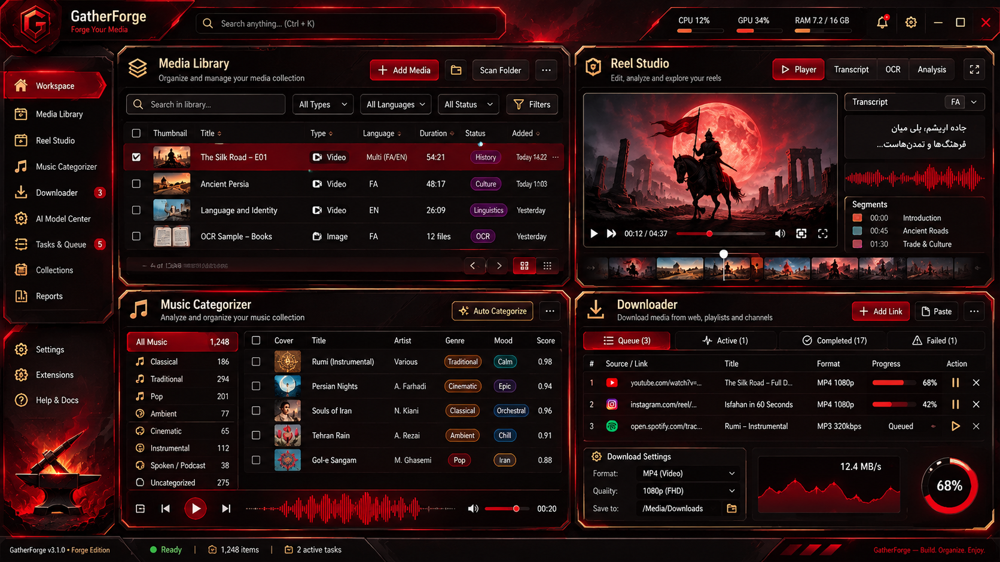

# Forge Native Desktop — integrated implementation



This is the agreed dark, angular, red-and-black Forge Edition design. Muted brass is reserved for borders and secondary controls. The previous purple/glass mockups are not the target.

## UI structure

- Full-width command bar and sharp-edged, dark-crimson navigation
- Workspace with four simultaneous functional panels
- Combined media table for real saved audio records and downloaded Reels
- Reel Studio: browse real local video assets, actual native preview, original caption and verified analysis evidence, manual category and approve actions
- Music Categorizer: artist groups and resizable data table, selection, audio playback, keep/review/skip, rename artist, scan, stage, publish, restore, finalize with confirmation
- Downloader: real job queue, HTTPS URL input, music/Reel mode, cancel, retry, speed and status
- AI Models: project-local model catalog; install/verify through the existing Rust checksum-verifying model engine
- Tasks & Queue, Settings, light/dark toggle

The Rune frontend imports the existing Rust core modules rather than displaying fabricated rows. The original `GatherForge-Rust-Linux` executable stays available, and its native model engine supplies the model CLI used by the Rune frontend.

## Engine ownership

| Concern | Owner |
|---|---|
| Rendering, layout and animation | Rune, pinned revision `1633f8d6c4f4f5804320ced1be4317e1ad4a9033` |
| Tables and generic controls | Rune Kit, same pinned revision |
| Advanced virtualized data layout concepts | GPUI Kit behavior reference (not embedded GPUI runtime) |
| Familiar component design | shadcn variants/tokens as style reference (not an egui runtime inside Rune) |
| Track files, duplicate policy, staging, publication | Existing Rust `library.rs` |
| Instagram local Reel manifests | Existing Rust `instagram.rs` |
| Local ASR/OCR pipeline | Existing project `tools/reel_analysis.py` (invoked explicitly on workers) |
| Download jobs | Existing Rust `jobs.rs` and `downloader.rs` |
| AI model lifecycle | Existing Rust `ai_models.rs` via `--forge-model` command |

## Risk and truthfulness

The source was produced from `MusicOrganizer_context_20261110_114114_105865.zip`. The Python suite passed in this environment, but **there was no Rust compiler or graphical Fedora display available here.** Accordingly, the UI implementation is source-complete for the stated views but **not yet a verified build, feature-parity release or pixel-perfect match** to the image. The installer is responsible for a real Cargo build before placing an executable. Compiler feedback and Fedora screenshots will establish whether adjustments are necessary.

Existing advanced native egui flows remain available until the Rune integration has been proven equivalent. No automatic Instagram unsaving is enabled. Never run two instances writing to the same download queue at once. No fake analysis output, auto-delete or model-success reporting.

## Launch

```bash
cd /mnt/shared/Projects/MusicOrganizer
./GatherForge-Rune-Linux
```

The original application remains `./GatherForge-Rust-Linux`.


### Integrated visual-parity update
- Reworks header, sidebar, navigation, panels, footer, denser tables, responsive four-pane layout, real row album art, actual Reel filmstrip frames and transcript evidence inspector.
- Loads decorative emblem/anvil assets cropped from the approved reference (no fake media entries).
- Samples CPU and memory from `/proc`; does not invent system metrics when unavailable.
- Extracts stills and waveforms from local files with FFmpeg on background workers; failure is nonfatal.
- Rune `Player` failure is shown with the decoder message and an explicit `ffplay` fallback; this does not guarantee in-window playback on every codec.
- Original media operations remain behind approval/confirmation controls and are not executed by preview workers.
