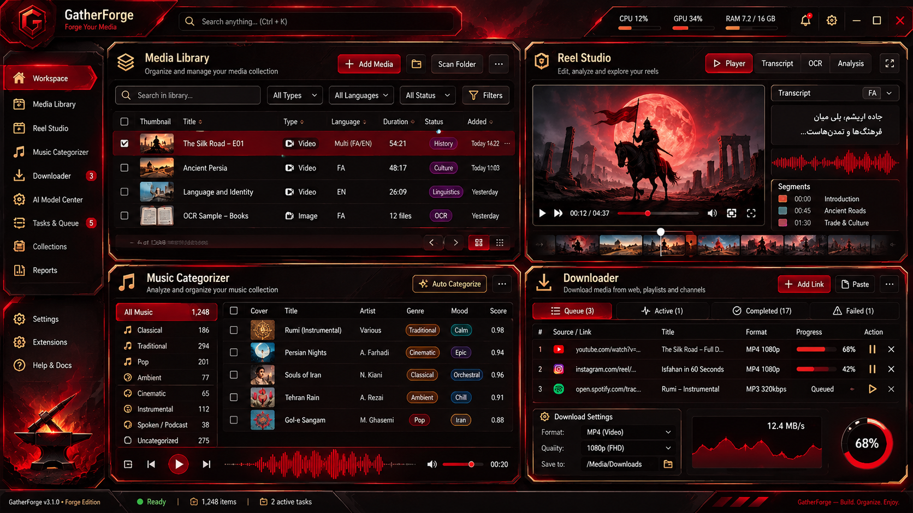

# GatherForge Forge Edition — UI/UX design reference



The reference is a **concept**, not a screenshot of implemented features. It defines the design direction agreed in the conversation. The prior light concept is included as `design/forge_reference_light_early.png`; it is **not** the final sharp-edge light palette.

## Visual design contract

- **Mood:** forged metal, cut edges, architectural desktop productivity. Not glassmorphism, neumorphism, or soft cards.
- **Primary surfaces:** nearly black with a dark crimson undertone, not charcoal-neutral. Light surfaces are warm paper/steel.
- **Accent:** bold red (`#F13A3D` in dark; `#B21C25` in light). Reserve it for selected navigation, active status, primary actions, progress, and active waveform regions.
- **Gold:** muted brass (`#CB9652`) for one-pixel keylines, secondary buttons, icons, and selection hints. Do **not** fill entire backgrounds with gold.
- **Corners:** normally 2px. Existing music-card and artwork exception: 8px, per `GATHERFORGE_CORNER_RULE_V1`. Angled chrome can be drawn with non-rectangular polygons.
- **No fake glass:** use opaque panel surfaces; no blur simulation, translucent overlays on every card, or large soft glows. Add restrained focus and hover cues.
- **Typography:** clear high-contrast hierarchy. Right-to-left Persian and Arabic text must be tested with real font shaping/IME and mixed-direction examples.
- **Accessibility:** real keyboard navigation, visible focus, reduced-motion support, statuses distinguishable without color alone.
- **Motion:** Rune spring motion on pane transitions *only where it helps navigation*, no constantly moving decoration.

## Information architecture

| Destination | Content | Main interactions | Existing workflow |
| --- | --- | --- | --- |
| Workspace | Four-module operational overview with live counts | Navigate to a module; scan music folder | `Page::Overview` |
| Media Library | Combined indexed music and Reels, searchable | Open dedicated music/reel experience | Added in Forge Batch 01 |
| Reel Library / Studio | Reel cards, media preview, OCR, multilingual speech evidence, review states | Filter, preview, analyze, approve where safe | `Page::ReelManifest` |
| Music Categorizer | Track index, artist folders, duplicate flags, review states | Scan, edit, stage, publish only with explicit confirmation | `Page::Library` + Duplicates + Artists |
| Downloader | Unified persistent music and Reel queue | Add links, monitor progress, retry, inspect errors | `Page::Manager`, Downloads and ReelDownload |
| AI Models | Model catalog, install verification, language routing | Install, verify, choose model | `ai_models::Panel` in Settings |
| Settings | Dark/light, language preferences, paths, performance | Change preferences | `Page::Settings` |

## Non-destructive interaction rules

- No automatic deleting, unsaving, publishing, or finalization as a side effect of navigation.
- Reveal source URLs and files without changing them.
- Download job cancellation should retain already downloaded media.
- Auto-language is a separate audio-vs-OCR decision; automatic is the default goal, not a claim that unsupported languages are recognized.
- Show uncertainty and partial recognition explicitly.
- Keep the old egui frontend usable until feature parity tests pass for the new Rune frontend.

## Rendering architecture

```text
GatherForge core (library, downloader, jobs, instagram, reel_flow, ai_models)
     ↑ stable application service APIs, typed DTOs + event channel (to be extracted)
     ├── existing egui/eframe frontend (shipping, Forge Batch 01 visual update)
     └── Rune + Rune Kit native frontend (separate experimental executable)
           ├── Forge tokens and accessible component variants
           ├── Rune Kit built-ins first (buttons/table/tree/shell)
           ├── GPUI Kit behavior reference for advanced data/virtualization/docking
           └── shadcn variants reference (NOT egui widgets in Rune renderer)
```

**Rune + GPUI + egui are not composable into one renderer.** Experimental GPUI Kit and egui-shadcn dependencies are isolated to avoid breakage of the production build.

## Implementation checklist

- [x] Pin design reference in repository documentation.
- [x] Add crimson/black/brass dark palette and matching sharp light palette to existing app.
- [x] Replace old circular/glass branding and navigation highlights with angular Forge styling.
- [x] Add four-module operational Workspace view using real local counters.
- [x] Add combined Media Library screen that displays indexed music and Reel records.
- [x] Preserve all existing downloader, categorizer, Reel, model and safety logic.
- [x] Add isolated Rune/Rune Kit interactive preview and GPUI/egui reference manifests.
- [ ] Compile Rune preview on user Fedora and validate exact pinned revision.
- [ ] Extract backend service interfaces and connect real data to Rune.
- [ ] Implement advanced Rune Reel Studio timeline and GPUI-inspired docking.
- [ ] Integrate Rune data table, keyboard shortcuts, file previews, and theme switch.
- [ ] Verify RTL font shaping, mixed-script editing, Linux/Windows/macOS deployment.
- [ ] Retire egui only after comparable production tests and explicit review.

This document should not be used as a claim that migration is complete. The snapshot is from 2026-11-10 and actual project revisions may have changed since.
